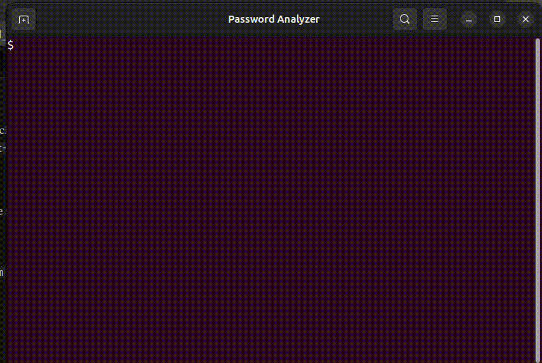

# Password Analyzer (Go)


A command-line tool written in Go that analyzes password strength, checks whether a password has appeared in real data breaches, and estimates how long it would take to crack.

##  Features

-  **Strength analysis**: length, entropy (in bits), a 1-5 score, and a strength label with a bar
-  **Weak-pattern warnings**: ascending sequences, repeated characters, common substrings and keyboard walks
-  **Common password list**: checked against an embedded `common-passwords.txt`
-  **Breach check**: finds out if the password appeared in known leaks (Have I Been Pwned)
-  **Crack-time estimate**: average time for an offline attack
-  **Batch mode** (`-file`): check a whole list of passwords at once
-  **JSON export** (`-json`): machine-readable output for scripts
-  **Hidden input**: your password is not shown as you type
-  Unit tests and GitHub Actions CI

##  Demo



## Getting started

Requires [Go](https://go.dev/dl/) 1.25 or newer.

```bash
git clone https://github.com/bhimsen145/Password-Analyzer-go.git
cd Password-Analyzer-go
go run .
```

> Use `go run .` (with the dot), not `go run main.go`. The program is split across several files, and the dot compiles all of them.

Then type a password at the prompt. It is hidden as you type.

## Usage

```bash
go run .                          # interactive mode with breach check
go run . -offline                 # skip the online breach check
go run . -file passwords.txt      # batch mode: one password per line
go run . -file passwords.txt -json
go test ./...                     # run the tests
```

| Flag | Description |
|---|---|
| `-file <path>` | Check every password in a text file (one per line) |
| `-json` | Print batch results as JSON |
| `-offline` | Skip the online breach check |

Batch mode never prints the passwords themselves, only their line numbers. It exits with code `1` if any password was found in a breach, so it works in scripts and CI.

## How the breach check protects your privacy (k-anonymity)

Your password is **never sent anywhere**:

1. It is hashed locally with SHA-1
2. Only the **first 5 characters** of the hash are sent to the API
3. The API returns every leaked hash that starts with those 5 characters
4. The rest of the hash is compared **on your own machine**

So the service can't tell which password you checked. SHA-1 is used here only as a lookup key, never to store passwords.

## How crack time is estimated

```
average time = 2^entropy / 2 / 10,000,000,000 guesses per second
```

This models an offline attack on a fast hash with a modern GPU rig.

**Limitation:** the estimate assumes a truly random password. Real attackers try common words and patterns first, so human-chosen passwords like `Summer2024!` fall much faster than the number suggests. Treat it as a rough guide.

## What entropy means

Entropy measures how unpredictable a password is:

```
entropy = length × log2(size of the character pool)
```

The pool grows with the character types you use: lowercase (26), uppercase (26), digits (10) and symbols (32). Longer passwords usually add more strength than extra symbols do.

## Project structure

| File | Purpose |
|---|---|
| `main.go` | Interactive mode, scoring and warnings |
| `breach.go` | Breach check (Have I Been Pwned, k-anonymity) |
| `crack.go` | Entropy and crack-time estimate |
| `report.go` | Per-password report for batch and JSON mode |
| `cli.go` | Command-line flags |
| `common-passwords.txt` | Common password list, embedded at build time |
| `*_test.go` | Unit tests (the HTTP tests use a fake local server) |

## Roadmap

- [ ] Passphrase generator
- [ ] Load a larger common-password list
- [ ] Colored terminal output
- [ ] Simple web interface

## Disclaimer

This is an educational project. The strength score and crack-time figures are estimates, not guarantees. For real accounts, use a password manager and turn on two-factor authentication.

## License

MIT. See [LICENSE](LICENSE).